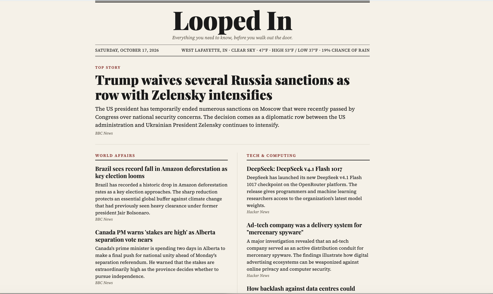

# Looped In

**A daily news briefing, written by an AI agent and delivered as a newspaper-style front page and an email.**

Looped In reads the news every morning, decides what matters, writes a short blurb for each story, and publishes a one-page "front page" you can open in a browser or receive in your inbox. Every headline links to the original article.



## What it does

- **Curates, not just collects.** An LLM agent chooses its own tools (news categories, Hacker News) and picks the top 6 to 8 stories based on a configurable set of interests.
- **Expands your horizons.** Every briefing includes a "Curveball", one story outside your usual interests.
- **Keeps the tone balanced.** The editor prompt caps how many tragedy stories lead the page.
- **Links only to real articles.** After the agent finishes, plain Python checks every story URL against the URLs the tools actually returned and removes anything that doesn't match, so the agent can't invent a link.
- **Shows local weather.** Current conditions, high, low, and chance of rain from Open-Meteo.
- **Runs by itself.** A scheduled job rebuilds the page and emails it every morning.

## How it works

```
 schedule (7 AM)
      |
      v
  agent.py ──► Gemini ◄──► tools: get_headlines (BBC RSS), get_hacker_news
      |
      |  structured JSON (headline story, sections, curveball, one-liner)
      v
  check_urls()   drops any story whose link no tool returned
      |
      +──► weather.py (Open-Meteo, plain code, no AI)
      |
      v
  briefing.json ──► build_page.py ──► index.html   (browser)
                └─► send_email.py ──► inbox        (email)
```

The core idea is a clean split between **the agent**, which makes judgment calls and outputs structured data, and **the display layer**, which turns that data into HTML. Either side can change without touching the other.

### The agent loop

`agent.py` runs a plain tool-calling loop with no framework:

1. Send the model a goal, an editor prompt, and descriptions of the available tools.
2. If the model asks to call a tool, run the real Python function and send the result back.
3. Repeat until the model replies with its final JSON, or a maximum step count is reached.

### Design decisions

| Decision | Why |
|---|---|
| Weather is fetched by plain code, not by the agent | It needs no judgment, so fetching it directly is cheaper and more reliable. |
| Every URL is verified against tool output | Prompts ask for no made-up links; code guarantees it. |
| Retries with exponential backoff, then a fallback model | The free API tier returns temporary 503 errors during demand spikes and has a daily quota. |
| Read-only tools and a step limit | The agent can't change anything or loop forever. |
| Separate email template | Email clients ignore CSS variables, grid layout, and web fonts, so the email uses simple table layout with inline styles. |

## Tech stack

- Python 3.9+
- [Google Gemini API](https://ai.google.dev/) (free tier) via `google-genai`
- [Open-Meteo](https://open-meteo.com/) for weather (no API key)
- BBC News RSS feeds (via `feedparser`) and the Hacker News API
- Jinja2 for the HTML page and the email
- `smtplib` with a Gmail app password for delivery
- macOS `launchd` for scheduling

## Project structure

```
looped-in/
├── agent.py              # Agent loop, editor prompt, URL check, entry point
├── news_tools.py         # get_headlines (RSS) and get_hacker_news
├── weather.py            # get_weather (Open-Meteo)
├── build_page.py         # Renders briefing data into index.html
├── send_email.py         # Renders and sends the email
├── hello.py              # Minimal API call, useful as a connection test
├── sample_briefing.json  # Sample data for working on the design without API calls
└── templates/
    ├── front_page.html   # Newspaper-style web page
    └── email.html        # Email-safe version
```

## Setup

**1. Clone and create a virtual environment**

```bash
git clone https://github.com/YOUR-USERNAME/looped-in.git
cd looped-in
python3 -m venv .venv
source .venv/bin/activate
pip install google-genai python-dotenv requests feedparser jinja2
```

**2. Get a free Gemini API key** at [aistudio.google.com](https://aistudio.google.com). No credit card is needed.

**3. Create a `.env` file** in the project root:

```
GEMINI_API_KEY=your-gemini-key

# Optional: only needed for email delivery
EMAIL_ADDRESS=sender@gmail.com
EMAIL_APP_PASSWORD=your-16-character-app-password
EMAIL_RECIPIENTS=you@example.com,friend@example.com
```

`.env` is listed in `.gitignore`. Never commit it. For email, use a dedicated Gmail account with 2-Step Verification on, then create an [app password](https://myaccount.google.com/apppasswords).

**4. Set your location and interests**

- Weather location and units: `LOCATION` and `UNIT` at the top of `weather.py`.
- Interests, models, and step limit: the settings block at the top of `agent.py`.

## Usage

```bash
python agent.py              # run the agent, build index.html, send email, open the page
python agent.py --no-open    # same, without opening the browser (used by the scheduler)
python build_page.py         # rebuild the page from the last briefing.json, no API calls
python send_email.py         # resend the last briefing, no API calls
```

Each run of `agent.py` makes about two to three model requests. `build_page.py` and `send_email.py` make none, so you can iterate on the design freely.

## Scheduling on macOS

Create `~/Library/LaunchAgents/com.example.loopedin.plist` that runs the venv's Python on `agent.py --no-open` at the hour you want:

```xml
<?xml version="1.0" encoding="UTF-8"?>
<!DOCTYPE plist PUBLIC "-//Apple//DTD PLIST 1.0//EN" "http://www.apple.com/DTDs/PropertyList-1.0.dtd">
<plist version="1.0">
<dict>
  <key>Label</key><string>com.example.loopedin</string>
  <key>ProgramArguments</key>
  <array>
    <string>/Users/YOU/looped-in/.venv/bin/python</string>
    <string>/Users/YOU/looped-in/agent.py</string>
    <string>--no-open</string>
  </array>
  <key>WorkingDirectory</key><string>/Users/YOU/looped-in</string>
  <key>StartCalendarInterval</key>
  <dict><key>Hour</key><integer>7</integer><key>Minute</key><integer>0</integer></dict>
  <key>StandardOutPath</key><string>/tmp/loopedin.log</string>
  <key>StandardErrorPath</key><string>/tmp/loopedin.log</string>
</dict>
</plist>
```

Load it and trigger a test run:

```bash
launchctl bootstrap gui/$(id -u) ~/Library/LaunchAgents/com.example.loopedin.plist
launchctl kickstart gui/$(id -u)/com.example.loopedin
cat /tmp/loopedin.log
```

**Keep the project outside `~/Documents`, `~/Desktop`, and `~/Downloads`.** macOS blocks background jobs from reading those folders, and the job fails with `Operation not permitted`.

## Limitations

- Scheduling only runs while the Mac is on or asleep, not shut down.
- Everyone on the email list gets the same briefing, including the same weather location.
- Blurbs are written from headlines and RSS summaries, not full article text, so they stay modest by design.
- The free Gemini tier has a daily request quota and occasional capacity errors. Model names also change over time, so update `MODELS` in `agent.py` if you see a `404`.

## Ideas for next steps

- Chrome new-tab version
- Run on GitHub Actions so it works when the laptop is off
- Per-person interests and locations
- More news sources and a sports section

## About

Built as a learning project to understand how AI agents work: tool calling, structured output, guarding against hallucinated links, and scheduling a real daily job. The agent loop is written from scratch, without a framework, to keep the mechanics visible.
